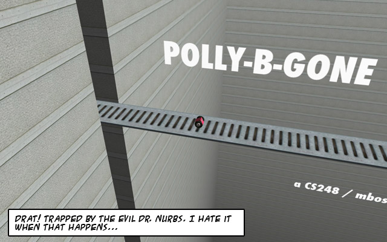
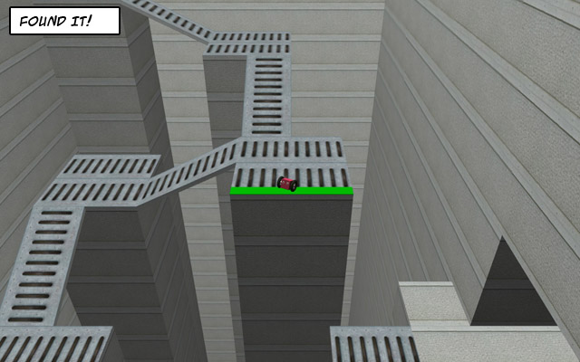
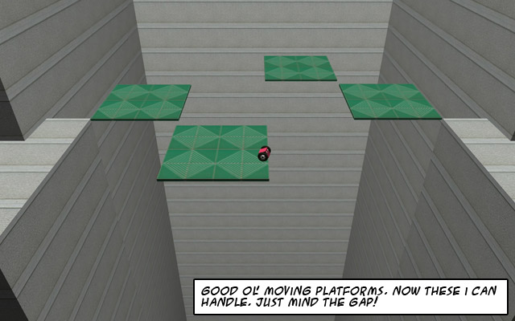
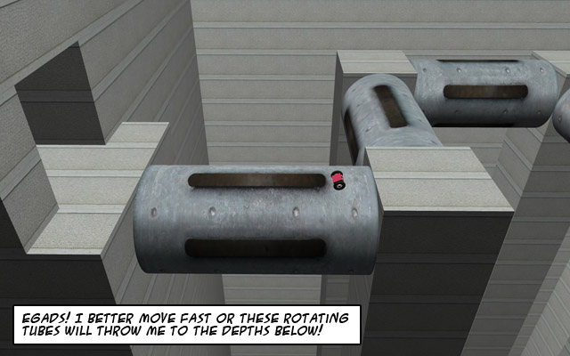
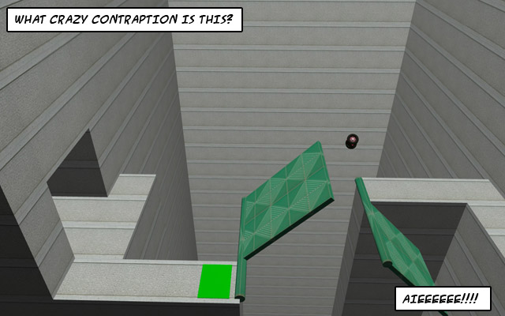
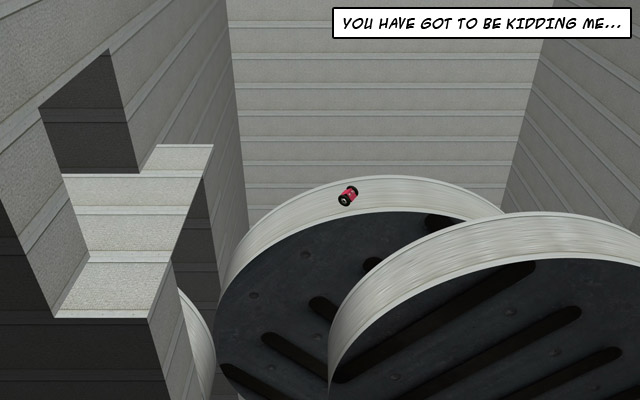

# Polly-B-Gone

[https://cs.stanford.edu/people/mbostock/polly/](https://cs.stanford.edu/people/mbostock/polly/)

**Polly-B-Gone** is a 3D physics platform game that tells the story of a plucky wheeled robot named Polly, who has been imprisoned by the nefarious Dr. Nurbs in his laboratory. Polly must overcome a series of increasingly-elaborate obstacles to escape and regain her freedom. Polly was my entry in the 2008 [CS 248](https://graphics.stanford.edu/courses/cs248-08/) video game competition, and she won the grand prize!

## Screenshots








## Documentation

The entire game world for Polly-B-Gone is specified as an XML file. You can edit world.xml to create new levels, new puzzles, and even change the music, textures and lighting! See the [full specification](doc/xml-format.html) or [wiki](https://github.com/mbostock/polly-b-gone/wiki) for details.

## Controls

 * Movement: WASD or arrow keys
 * Next/previous room: Page Up/Page Down
 * Reset room: R or Backspace
 * Pause game: Space or Pause
 * Volume control: + and -
 * Exit game: ESC or Alt+F4
 * Toggle shader: F9
 * Toggle debugging mode: F10
 * Toggle fullscreen: F11

Simple gamepad supported is available but the game does not manage multiple gamepads simultaneously.

## Building

The following dependencies are required for building on Ubuntu/Debian:
```
sudo apt install \
  build-essential \
  pkg-config \
  libgl1-mesa-dev \
  libglu1-mesa-dev \
  libgles2-mesa-dev \
  libglut-dev \
  libsdl2-dev \
  libsdl2-image-dev \
  libsdl2-mixer-dev \
  libtinyxml2-dev
```
